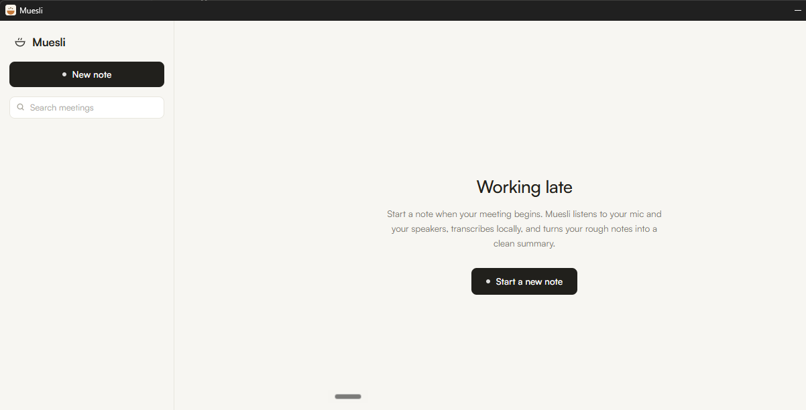

# Muesli

> [!TIP]
> **Configuração recomendada (gratuita e rápida):** Recomenda-se utilizar o **Groq** via chave(s) de API (**é gratuito — basta criar uma conta na plataforma [console.groq.com](https://console.groq.com)**) como motor de transcrição via **Whisper** (`whisper-large-v3-turbo`) e como provedor de **Modelos de IA**, configurando o modelo **`qwen/qwen3.8-27b`**. Você também pode cadastrar múltiplas chaves de API para rotação automática e ativar o envio em lote nas configurações para economizar limites.

**Uma alternativa gratuita e de código aberto ao Granola para Windows.** O Muesli é um
bloco de notas de reuniões com IA que registra notas sem que um bot entre na chamada. Ele
captura o microfone e o áudio do sistema diretamente, transcreve a reunião localmente com
o Whisper e transforma suas notas brutas em um resumo limpo e estruturado. Sem conta,
nuvem, assinatura ou telemetria. Suas reuniões nunca saem do computador.




Funciona com **Zoom, Google Meet, Microsoft Teams, Webex, chamadas do Slack, chamadas
telefônicas no viva-voz e reuniões presenciais**, porque escuta seus dispositivos de
áudio em vez de se conectar a uma plataforma específica de reuniões.

## Por que o Muesli

O Granola é um ótimo produto, mas funciona por assinatura paga e o áudio e as
transcrições das suas reuniões passam pela nuvem. O Muesli tem a mesma ideia central,
recriada para funcionar inteiramente na sua máquina e de graça:

| | Muesli | Granola |
|---|---|---|
| Preço | Gratuito, licenciado sob MIT | Assinatura após o período de teste |
| Um bot entra na reunião | Não | Não |
| Onde o áudio é processado | Seu computador (Whisper local) | Transcrição na nuvem |
| Onde as notas ficam | SQLite local em `%APPDATA%` | Nuvem deles |
| Conta necessária | Nenhuma | Sim |
| Aprimoramento por IA | Ollama local, sua própria chave de API ou um resumidor offline integrado | Modelos na nuvem |
| Suporte ao Windows | Sim, Windows em primeiro lugar | Sim |
| Funciona offline | Sim (após o download inicial do modelo) | Não |

## Recursos

- **Captura sem bot**: grava seu microfone e seus alto-falantes (loopback WASAPI), ouvindo
  todos os participantes em qualquer plataforma e identificando-os como "Eu" e "Outros".
- **Transcrição local ao vivo**: conversão de fala em texto por streaming com
  faster-whisper na sua CPU. Nada é enviado para a nuvem.
- **Notas brutas entram, notas limpas saem**: escreva tópicos durante a chamada, clique
  em Aprimorar depois, e suas notas serão combinadas com a transcrição em um resumo
  estruturado. Suas notas funcionam como âncoras: escreva "preocupações com preços" e
  todos os momentos relacionados a preços serão incluídos.
- **Modelos**: Automático, 1:1, Daily, Reunião semanal, Vendas/Descoberta, Entrevista,
  além dos seus próprios modelos personalizados.
- **Converse com suas reuniões**: pergunte "o que decidimos?" ou "redija um e-mail de
  acompanhamento", com escopo de uma reunião ou de todas elas, usando suas transcrições
  como base.
- **Biblioteca e pesquisa**: pesquisa de texto completo em todas as transcrições, notas
  e resumos.
- **Exportação**: exportação em Markdown e cópia para a área de transferência.
- **Gratuito por padrão, melhor com mais recursos**: sem instalar nada, você ainda tem um
  bom resumo extrativo. Instale o [Ollama](https://ollama.com) para obter IA local
  gratuita ou adicione uma chave da OpenAI, Anthropic ou Groq para resultados mais
  rápidos e precisos. As chaves ficam em um arquivo local.
- **Privacidade em primeiro lugar**: o áudio é transcrito na memória e descartado
  (a retenção é opcional), as notas ficam em um SQLite local e não existe telemetria de
  nenhum tipo.

## Instalação

### Opção 1: baixar o aplicativo (sem precisar do Python)

1. Baixe `Muesli-windows-x64.zip` na [versão mais recente](../../releases/latest).
2. Descompacte em qualquer lugar (por exemplo, `C:\Apps\Muesli`).
3. Execute `Muesli.exe`. O Windows SmartScreen pode avisar que a compilação não é
   assinada: clique em "Mais informações" e depois em "Executar assim mesmo", ou compile
   a partir do código-fonte.

### Opção 2: executar a partir do código-fonte

```
git clone https://github.com/shivankoctupie/muesli
cd muesli
run.bat
```

O `run.bat` cria um ambiente virtual do Python, instala as dependências e inicia o
aplicativo. É necessário ter Windows 10/11 e Python 3.10 a 3.12 no `PATH`. Depois da
primeira execução, o aplicativo inicia em poucos segundos. O `run_debug.bat` inicia o
aplicativo com um console e as ferramentas de desenvolvimento.

Em ambos os casos, a primeira gravação baixa o modelo Whisper "base" (cerca de 75 MB) e
a fonte Satoshi da interface. Portanto, mantenha a internet ativada uma vez. Depois
disso, o Muesli funciona totalmente offline.

## Como usar

1. Clique em **Nova nota** quando sua reunião começar. A transcrição ao vivo começa
   imediatamente.
2. Escreva notas brutas no painel esquerdo enquanto a transcrição é criada à direita.
3. Clique em **Parar**, escolha um modelo e clique em **Aprimorar notas**.
4. Faça perguntas na barra de conversa ou use as ações de um clique **Itens de ação** e
   **E-mail de acompanhamento**.
5. Encontre e pesquise tudo depois na biblioteca da barra lateral.

O Muesli fica na bandeja do sistema: fechar a janela a oculta; clique com o botão direito
no ícone da bandeja para sair. A inicialização automática fica em Configurações.

## Microfone e áudio do sistema no Windows

- **Permissão do microfone**: Configurações > Privacidade e segurança > Microfone.
  Ative "Acesso ao microfone" e "Permitir que aplicativos da área de trabalho acessem
  seu microfone".
- **O áudio do sistema** não precisa de permissão; o Muesli o captura por loopback WASAPI
  no seu dispositivo de saída padrão. Escolha um dispositivo específico em Configurações
  > Áudio.
- Durante a gravação, o Muesli reproduz silêncio no dispositivo de saída. Isso é
  inaudível e intencional: o Windows só fornece dados de loopback enquanto o dispositivo
  está ativo, e isso mantém a captura estável durante períodos silenciosos.
- Nenhum dispositivo de loopback listado? Atualize o driver de áudio, verifique se há um
  dispositivo de reprodução padrão definido e clique em "Atualizar dispositivos" em
  Configurações > Áudio. O Muesli usa a gravação somente pelo microfone como alternativa,
  exibindo um aviso, para que uma reunião nunca seja perdida por completo.
- Se você trocar de dispositivo de saída durante a reunião (por exemplo, ao conectar
  fones de ouvido), pare e inicie a nota novamente; a captura continua vinculada ao
  dispositivo usado no início.

## Opcional: IA mais inteligente

- **Ollama (gratuito e local)**: instale pelo [ollama.com](https://ollama.com) e baixe um
  modelo (`ollama pull llama3.2:3b` é rápido na CPU; `qwen3:8b` é mais inteligente,
  porém mais lento). O Muesli o detecta automaticamente.
- **Chaves de API (pagas e mais rápidas)**: adicione uma chave da OpenAI, Anthropic ou
  Groq em Configurações > Modelos de IA. Uma chave configurada é priorizada
  automaticamente; remova-a e o Muesli usará o Ollama e depois o resumidor integrado.
  As chaves são armazenadas apenas em `%APPDATA%\Muesli\settings.json` e enviadas
  somente ao provedor configurado.
- **Transcrição na nuvem (opcional)**: altere Configurações > Transcrição para as APIs
  Whisper da OpenAI ou Groq. Se uma chamada à nuvem falhar durante a reunião, o Muesli
  volta ao Whisper local para que a transcrição continue.

## Perguntas frequentes

**O Muesli é realmente gratuito?**
Sim. Ele é licenciado sob MIT, sem período de teste, recursos bloqueados ou conta. O
Whisper local e o resumidor integrado não custam nada. O Ollama também é gratuito.
As chaves de API são opcionais e cobradas pelos respectivos provedores, não pelo Muesli.

**Ele funciona com Zoom / Google Meet / Teams?**
Sim, e com qualquer outra coisa que produza som no seu PC. O Muesli captura o áudio do
dispositivo, não de um aplicativo específico, portanto não há integração para quebrar
nem participante-bot visível para as outras pessoas na chamada.

**Meu áudio é enviado para algum lugar?**
Não. O áudio é capturado, transcrito na sua CPU e descartado (a menos que você ative a
retenção em Configurações). As transcrições e notas ficam em um banco SQLite local. O
único tráfego de rede é o download inicial do modelo e da fonte, além de qualquer
provedor de IA que você configurar explicitamente.

**Preciso de uma GPU?**
Não. O modelo Whisper "base" padrão transcreve ao vivo em uma CPU comum de notebook.
Modelos maiores (small/medium) estão disponíveis em Configurações caso sua máquina
consiga executá-los.

**Qual é a diferença em relação a outros anotadores de código aberto?**
A maioria das alternativas entra nas chamadas como um bot, grava apenas o microfone ou
precisa de uma API de transcrição paga. O Muesli oferece captura em dois canais sem bot
(você e todos os demais), STT local, aprimoramento de notas ancorado nas suas próprias
notas brutas, modelos e conversa com suas reuniões, tudo pronto para usar.

**Devo avisar as pessoas de que estou gravando?**
Sim. As leis sobre gravação variam conforme a região, e pedir consentimento é uma
questão básica de cortesia. Configurações > Geral tem um lembrete opcional com um trecho
de divulgação de uma linha que você pode ler ou colar no chat da reunião.

## Teste completo verificado

O repositório inclui um autoteste (`tests\test_e2e.py`) que reproduz uma reunião
roteirizada pelos alto-falantes e executa todo o pipeline real. Resultado na máquina de
desenvolvimento (Windows 11, áudio Realtek, somente CPU, Ollama qwen3:8b), 07/07/2026:

- Captura do microfone + loopback WASAPI: APROVADO
- Transcrição ao vivo por streaming: APROVADO, 4/4 palavras-chave de teste, participantes identificados corretamente
- Aprimoramento extrativo (sem LLM instalado): APROVADO
- Aprimoramento por LLM via Ollama local: APROVADO, decisões e itens de ação corretos
- Fundamentação da conversa ("Quem enviará a proposta de preços e quando?"): APROVADO
- Autoteste do executável empacotado (`Muesli.exe --selftest`): APROVADO

## Arquitetura, decisões e limitações

Um único processo Python: interface pywebview (WebView2), captura WASAPI com
PyAudioWPatch, STT com faster-whisper, SQLite + FTS5 para armazenamento e um roteador de
provedores (Anthropic / OpenAI / Groq / Ollama / extrativo integrado) para aprimoramento
e conversa. Consulte [DECISIONS.md](DECISIONS.md) para todas as decisões de projeto e
limitações conhecidas, incluindo o truque do mantenedor de silêncio do loopback WASAPI
que torna a captura sem bot confiável.

Limitações conhecidas: a identificação de participantes é uma heurística de energia
(não diarização), uma gravação por nota, nenhuma sincronização de calendário ainda e
executável não assinado. Contribuições são bem-vindas em todas essas áreas.

## Contribuindo

Issues e PRs são bem-vindos. Boas áreas para começar: diarização real, preenchimento
automático de calendário, detecção automática do início da reunião, empacotamento e
assinatura, além de versões para macOS/Linux (a camada de áudio é a única parte
específica do Windows). Execute a suíte de testes com
`.venv\Scripts\python.exe tests\test_e2e.py` (ela reproduz áudio em volume audível).

## Licença

[MIT](LICENSE). A fonte Satoshi não é distribuída com este repositório; cada instalação
a baixa do Fontshare sob sua EULA de fonte gratuita (consulte `ui/fonts/README.md`).
O Muesli é um projeto independente e não é afiliado nem endossado pela Granola Inc.
